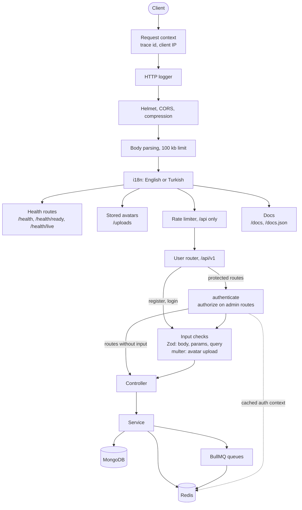
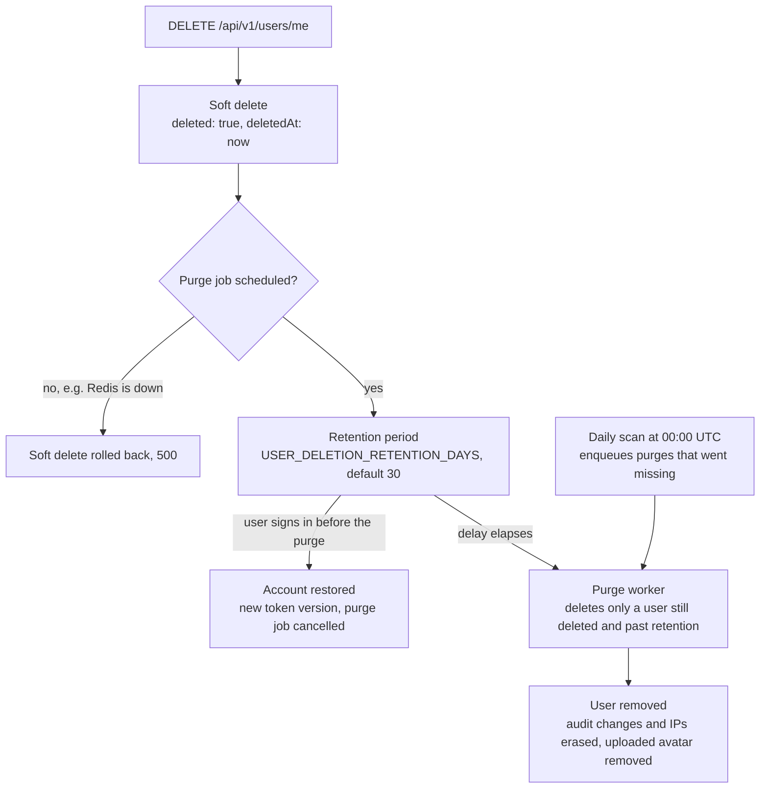

# node-ts-backend-starter

A REST API starter for **Node.js 26**, **Express 5**, **Mongoose 9** and **TypeScript**, with the
parts a production service needs from its first deploy: revocable JWTs, brute-force protection,
request validation and an OpenAPI document built from the same **Zod** schemas, soft delete with a
delayed purge, an audit log, tracked migrations, **BullMQ** jobs, structured logs and graceful
shutdown. The test suite needs neither Docker nor a running database.

- [Quick start](#quick-start)
- [API](#api)
- [Architecture](#architecture)
- [Design decisions](#design-decisions)
- [Configuration](#configuration)
- [Tests](#tests)
- [Project structure](#project-structure)
- [Known limitations](#known-limitations)

## Quick start

Requires Node.js 26 or later, MongoDB and Redis.

```bash
git clone https://github.com/ulasdnz/node-ts-backend-starter.git
cd node-ts-backend-starter
npm install
cp .env.example .env   # set MONGO_URI, REDIS_URL and JWT_SECRET, see Configuration
npm run migrate        # applies pending migrations, then builds indexes
npm run dev            # http://localhost:3000, with Swagger UI at /docs
```

`npm run seed` replaces every user with an admin, `admin@example.com`, and ten users
(`user1@example.com` onwards), all signing in with `Password123!`. It refuses to run in production,
and against a `MONGO_URI` on another machine unless run as `npm run seed -- --allow-remote`.

In production, build once, run the migrations before the new version takes traffic, then start it:

```bash
npm run build
npm run migrate:prod
npm start
```

| Script                             | What it does                                                       |
| ---------------------------------- | ------------------------------------------------------------------ |
| `npm run dev`                      | Starts the API with `.env` and restarts it on changes              |
| `npm run build` / `npm start`      | Compiles the app into an emptied `dist/` / runs the compiled app   |
| `npm run migrate` / `migrate:prod` | Applies pending migrations, then builds indexes (source / `dist/`) |
| `npm run migration:create <name>`  | Creates a timestamped migration from the template                  |
| `npm run seed`                     | Replaces every user with development data                          |
| `npm test` / `test:coverage`       | Runs the tests / runs them with coverage and its thresholds        |
| `npm run lint` / `typecheck`       | ESLint with type information / `tsc --noEmit`                      |
| `npm run check`                    | Lint, typecheck and tests                                          |

## API

The API is described by an OpenAPI 3.1 document generated at startup with
[zod-openapi](https://github.com/samchungy/zod-openapi). Request bodies, path parameters and query
parameters are built from the Zod schemas that validate them; the avatar upload, which multer checks
instead, is described by hand. Each module's `*.openapi.ts` adds the response schemas.

- `GET /docs.json` serves the document in every environment.
- `GET /docs` serves Swagger UI outside production. In production it answers `404`.

| Method | Path                        | Auth   | Description                                           |
| ------ | --------------------------- | ------ | ----------------------------------------------------- |
| POST   | `/api/v1/auth/register`     | —      | Register a user                                       |
| POST   | `/api/v1/auth/login`        | —      | Sign in; restores a deleted account not yet purged    |
| GET    | `/api/v1/users/me`          | Bearer | Get the signed-in user                                |
| PATCH  | `/api/v1/users/me`          | Bearer | Update the signed-in user                             |
| PATCH  | `/api/v1/users/me/password` | Bearer | Change the password; returns a new token              |
| PATCH  | `/api/v1/users/me/avatar`   | Bearer | Upload a new avatar                                   |
| DELETE | `/api/v1/users/me`          | Bearer | Delete the account; purged after the retention period |
| GET    | `/api/v1/users`             | Admin  | List users, page by page                              |
| GET    | `/api/v1/users/{id}`        | Admin  | Get a user by id, deleted users included              |
| GET    | `/health`                   | —      | Every dependency, for inspection                      |
| GET    | `/health/ready`             | —      | Readiness probe: should traffic be routed here?       |
| GET    | `/health/live`              | —      | Liveness probe: should the process be restarted?      |

_Bearer_ takes the token of any signed-in user, _Admin_ the token of an admin.

- `GET /api/v1/users` takes `page` (from 1), `limit` (1 to 100, default 20) and `sort`, a
  comma-separated list of `createdAt`, `email`, `name` and `surname`, with `-` for descending order
  (default `-createdAt`). `includeDeleted=true` adds deleted users and `onlyDeleted=true` lists only
  them.
- The avatar is one `multipart/form-data` file named `photo`: a JPEG, PNG or WebP image up to 5 MB,
  recognized by its content rather than its name. Stored avatars are served under `/uploads`.
- Passwords are 8 to 64 characters and at most 72 bytes, which is as much as bcrypt reads.

### Responses

| Request         | Body                                                                 |
| --------------- | -------------------------------------------------------------------- |
| Reads           | `{ data }`; lists add `meta.pagination`                              |
| Changes         | `{ data, message }`; a deletion answers `{ message }` alone          |
| Sign-in         | `{ data: { user, token } }`, with a `message` only after a restore   |
| Password change | `{ data: { token }, message }`; the new token replaces every old one |

```json
{
  "data": [{ "_id": "6720f0c2a1b2c3d4e5f60718", "email": "ada@example.com", "role": "user" }],
  "meta": { "pagination": { "page": 1, "limit": 20, "total": 42, "totalPages": 3 } }
}
```

### Errors

Every error has one shape:

```ts
{
  error: {
    code: string;       // stable and machine-readable, e.g. "auth.too_many_attempts"
    message: string;    // in the request's language, English or Turkish
    details?: Array<{ field: string; message: string }>;
    traceId?: string;   // the same value as the X-Trace-Id response header
    stack?: string;     // development only
  }
}
```

- Clients branch on `code`. `message` follows the `Accept-Language` header.
- A validation failure lists each failing field in `details`. The register, profile update and
  password change bodies also reject unknown fields instead of ignoring them.
- An unexpected error answers `500` with a generic message and its `traceId`.
- A `429` carries `Retry-After`. Requests under `/api` count against a per-IP rate limit and get
  `RateLimit-Limit`, `RateLimit-Remaining` and `RateLimit-Reset` headers.

## Architecture

A single service. At startup, loaders connect MongoDB and Redis, start the job workers and build the
Express app, in that order. A request then passes through this chain:



Any step can fail. The error handler at the end of the chain turns every error into the
[error shape](#errors), and an unknown path into a `404` of the same shape. Health checks, stored
avatars and docs sit outside `/api`, so they are not rate limited.

Deleting an account starts a lifecycle that ends in a purge:



If a restored account's purge job cannot be cancelled, the job stays queued and the worker skips the
user, who is no longer deleted. Purge jobs have one fixed id per user, so the daily scan never
queues a second purge for a user whose job still exists. A pending job is left alone; one that
failed every attempt or completed without purging the user is retried with a fresh set of attempts.

## Design decisions

### Token versions and revocation

A token is an HS256 JWT whose `sub` is the user id and whose `ver` is the user's token version. It
carries no role. Each request loads the role, the account state and the current token version from
an auth context cached in Redis for `AUTH_CONTEXT_CACHE_TTL_SECONDS`. A password change or an
account restore moves the user to the next version, which revokes every older token at once, even
one issued within the same second; a JWT's issue time has one-second precision, so comparing times
would miss it. Deleting an account ends its tokens too. Each of these clears the cached context, so
it applies on the next request. A role or activation change made directly in the database waits for
the cache to expire.

### Login protection

- An unknown email and a wrong password get the same answer after the same bcrypt work.
- `LOGIN_MAX_CONSECUTIVE_FAILS` failures in a row lock an email and IP pair for
  `LOGIN_BLOCK_DURATION_SECONDS`. Each IP also has a daily budget of
  `LOGIN_MAX_FAILS_PER_IP_PER_DAY` failures across all emails.
- The current-password check of a password change counts toward the same lock and budget, so a
  stolen token cannot be used to guess the password.
- The counters live in Redis. While Redis is unreachable, each instance counts in memory.

### Soft delete and purge

User deletion is guarded in three layers, each assuming the others may fail:

- **Commit time:** custom ESLint rules (`mongoose-safety/no-hard-delete`,
  `mongoose-safety/aggregate-policy`) reject hard deletes and unfiltered aggregations in the user
  module, and the pre-commit hook runs them through lint-staged.
- **Runtime:** a Mongoose plugin adds `deleted` and `deletedAt`, and hides deleted documents from
  every `find` query, `countDocuments()` and `distinct()` unless the query asks for `.withDeleted()`
  or `.onlyDeleted()`, or filters on `deleted` itself. It blocks `deleteOne()`, `deleteMany()` and
  `findOneAndDelete()`, and offers `softDeleteById()` and `restoreById()`. A plain `aggregate()` is
  not filtered; `aggregateSafe()` adds the filter to the pipeline, which is why the lint rule
  requires it.
- **Background:** the purge job and the daily scan shown above. The worker deletes through the raw
  collection with a filter that matches only a user still deleted and past retention.

### Audit log

A Mongoose plugin records `save()`, which `create()` goes through, and `findOneAndUpdate()` and
`findOneAndDelete()` on an audited model; other writes are not recorded (see
[Known limitations](#known-limitations)). The actor comes from the request context: the signed-in
user, `anonymous` in a request without one, or `system` outside requests, such as in jobs, along
with the trace id and the client IP. Sensitive fields such as `password` and `token` are masked at
any depth. Entries are written without holding up the operation they describe, and shutdown waits
for the pending ones. When a user is purged, the entries about the account lose their recorded
changes, and the entries of the user's own actions lose their IP.

### Migrations

Migrations change data that already exists. They run as a deploy step, never at startup. A run takes
a lock, so two deploys cannot apply the same migration twice. It applies pending migrations in file
name order, records each one in the `migrations` collection, then builds the indexes the schemas
declare. Index builds only add; dropping an index takes a migration of its own. See
[`src/database/migrations/README.md`](src/database/migrations/README.md) for writing one.

### Queues and Redis outages

Queues and workers come from one factory. Jobs get five attempts with exponential backoff from one
minute, and BullMQ keeps completed jobs for at least a day and failed ones for at least seven. A job
enqueued during a request carries that request's trace id. `WORKERS_ENABLED=false` makes an instance
serve HTTP only.

Redis speeds up the request path but is not a dependency of it:

- A failed cache read is a miss, and a failed cache write is skipped.
- The rate limiter and the login counters fall back to per-instance memory.
- `/health` reports `degraded` with `200`, and readiness ignores Redis, so an outage does not take
  every instance out of rotation at once.
- What needs Redis fails cleanly: an account deletion that cannot schedule its purge is rolled back.
- BullMQ remembers a failed first connection for good, so such a queue is rebuilt on its next use.

### Observability

Every request runs in an `AsyncLocalStorage` context holding a trace id, the client IP (`req.ip`,
which honours `TRUST_PROXY`) and, once authenticated, the user id. The trace id is the `X-Trace-Id`
header, or `X-Request-Id` when that is absent, if the value is well-formed; failing that it comes
from a W3C `traceparent` header, or is generated. It goes back in the `X-Trace-Id` response header.
A job enqueued during a request runs under that request's trace id; a scheduled job gets one of its
own, which the jobs it enqueues carry on.

Winston writes to stdout, and every line logged during a request or a job carries its trace id and,
once known, the user id. In production each line is a JSON object with the `severity` field Google
Cloud Logging reads; in development it is a readable line. Lines name their event, such as
`user.purge.completed`. Every request gets an `info` line when it completes, and the error handler
adds one line per error: `warn` for `401`, `403` and `429`, `debug` for other `4xx`, and `error`
with the stack trace for `5xx`.

### Graceful shutdown

On `SIGTERM` or `SIGINT` the HTTP server stops accepting connections, lets in-flight requests finish
and closes idle keep-alive connections; a readiness check that still arrives on an open connection
gets `503`. Then the jobs and Redis close, pending audit entries are written and MongoDB
disconnects: the reverse of the order they started in. `SHUTDOWN_TIMEOUT_MS` bounds the whole
sequence; past it the process exits with code 1. An unhandled rejection or uncaught exception is
logged and ends the process with exit code 1.

## Configuration

Copy `.env.example` to `.env` for local development. In production the platform provides the
variables. They are validated at startup, and an invalid value stops the app before it serves
anything.

| Variable                         | Default       | Description                                                       |
| -------------------------------- | ------------- | ----------------------------------------------------------------- |
| `NODE_ENV`                       | `development` | `development`, `production` or `test`                             |
| `PORT`                           | `3000`        | HTTP port                                                         |
| `LOG_LEVEL`                      | `info`        | Winston log level                                                 |
| `MONGO_URI`                      | —             | MongoDB connection string                                         |
| `REDIS_URL`                      | —             | Redis connection URL                                              |
| `JWT_SECRET`                     | —             | Token signing secret, at least 32 characters                      |
| `JWT_EXPIRES_IN`                 | `1d`          | Token lifetime with a unit: `900s`, `15m`, `12h`, `1d`            |
| `BCRYPT_SALT_ROUNDS`             | `10`          | bcrypt cost, from 4 to 15                                         |
| `AUTH_CONTEXT_CACHE_TTL_SECONDS` | `60`          | How long a user's role and account state stay cached              |
| `LOGIN_MAX_CONSECUTIVE_FAILS`    | `5`           | Failed sign-ins in a row that lock an email and IP pair           |
| `LOGIN_BLOCK_DURATION_SECONDS`   | `900`         | How long that lock lasts                                          |
| `LOGIN_MAX_FAILS_PER_IP_PER_DAY` | `100`         | Failed sign-ins one IP may make per day, across all emails        |
| `CORS_ORIGINS`                   | empty         | Allowed origins, comma-separated; empty allows any in development |
| `TRUST_PROXY`                    | `false`       | Proxies in front of the app, up to 10; required in production     |
| `RATE_LIMIT_POINTS`              | `100`         | Requests one IP may make per window under `/api`                  |
| `RATE_LIMIT_DURATION_SECONDS`    | `60`          | Rate limit window                                                 |
| `USER_DELETION_RETENTION_DAYS`   | `30`          | Days before a deleted account is purged for good                  |
| `SHUTDOWN_TIMEOUT_MS`            | `8000`        | How long shutdown may take before the process exits anyway        |
| `WORKERS_ENABLED`                | `true`        | `false` on instances that only serve HTTP                         |

## Tests

`npm test` runs Vitest. HTTP tests send real requests to the Express app through supertest,
mongodb-memory-server starts a throwaway MongoDB for the run, and no Redis is needed, so the suite
runs without Docker or any service to set up. Tests live next to the code they cover, in `__tests__`
folders. `npm run test:coverage` fails below 89% of lines, 88% of statements, 91% of functions or
76% of branches.

Two kinds of test keep the API document true to the code:

- **Route parity** reads the route tables of the health and user routers, as the app mounts them,
  and compares them with the operations in the document, in both directions. A route served but not
  documented fails it, and so does an operation documented but not served. The docs endpoints and
  the `/uploads` files are outside the comparison.
- **Response contract**: the user and health route tests pass every response through
  `expectDocumentedResponse`, which fails when the operation does not document the status or the
  body does not match the documented schema.

## Project structure

```
src/
├── app.ts           # Entry point: startup, signals, graceful shutdown
├── config/          # Environment schema, validated at startup
├── core/            # Express setup, middleware, errors, OpenAPI builder, shutdown
├── database/        # Migrations, soft delete and audit log plugins, seeders
├── jobs/            # Queue factory; user purge queue, worker and daily scan
├── lib/             # Logger, Redis clients, cache, file storage
├── modules/
│   ├── health/      # Probes, routes and their OpenAPI paths
│   └── user/        # Routes, controller, service, model, validators, OpenAPI paths
├── scripts/         # Migration scaffold
├── test/            # Global setup (a throwaway MongoDB) and helpers: Redis mock, OpenAPI checks
└── utils/           # Pagination, validators, timeouts
locales/             # English and Turkish messages
eslint/              # Custom Mongoose safety rules
```

## Known limitations

- **No refresh tokens.** A sign-in yields one access token that lives for `JWT_EXPIRES_IN`.
  Revocation goes through token versions instead.
- **Offset pagination.** Lists skip `(page - 1) * limit` documents, so deep pages get slower and
  writes made meanwhile can shift items between pages. A cursor would fix both.
- **Not every write is audited.** Only `save()`, `findOneAndUpdate()` and `findOneAndDelete()` are
  recorded; `updateOne()`, `updateMany()`, `insertMany()`, `bulkWrite()` and the other write methods
  leave no entry.
- **Per-IP limits use the whole IPv6 address.** The API rate limit and the login limits key on
  `req.ip`, so a client that owns an IPv6 /64 can rotate addresses for fresh budgets.
- **No audit log retention policy.** Entries stay until someone removes them; a purge only redacts
  them.
- **Token versions ended older sessions.** Tokens without a `ver` claim are rejected, so upgrading a
  deployment from a version without token versions signs every user out once.

## License

[MIT](LICENSE)
